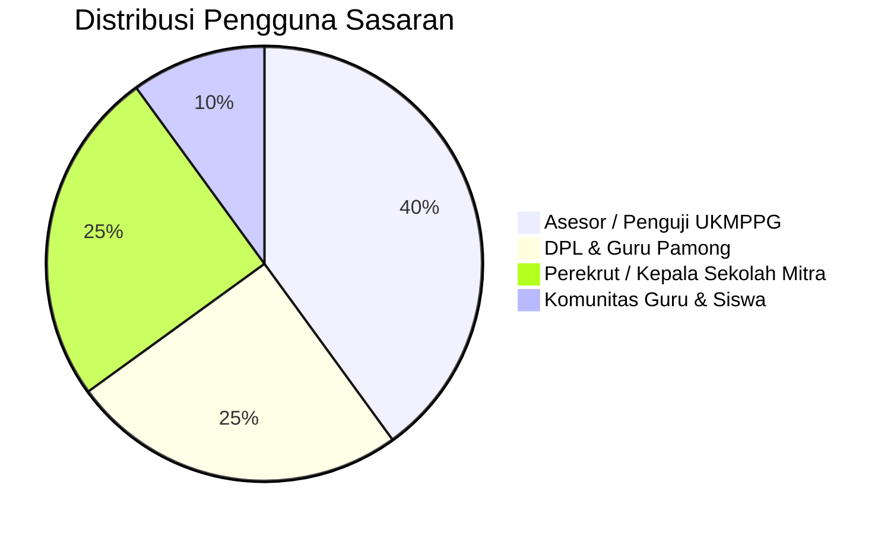
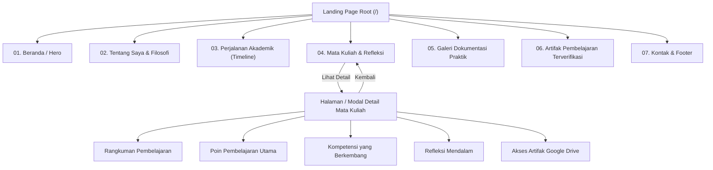
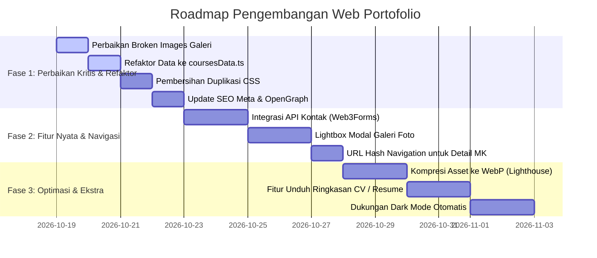

# Product Requirement Document (PRD)
# Web Portofolio Guru Profesional PPG Prajabatan

| Metadata | Keterangan |
| :--- | :--- |
| **Nama Proyek** | Web Portofolio PPG Prajabatan |
| **Pemilik Portofolio** | **Maswa Arbaurnika** |
| **Peran / Status** | Calon Guru Profesional — PPG Prajabatan 2026 |
| **Institusi / Bidang** | Pendidikan Profesi Guru (PPG) Prajabatan |
| **Versi Dokumen** | v1.0.0 |
| **Status Dokumen** | Approved / Living Document |
| **Tanggal Pembuatan** | Oktober 2026 |

---

## 1. Pendahuluan & Visi Produk

### 1.1 Latar Belakang
Program Pendidikan Profesi Guru (PPG) Prajabatan mewajibkan setiap calon guru untuk menyusun portofolio digital komprehensif sebagai instrumen penilaian Uji Kompetensi Mahasiswa PPG (UKMPPG). Portofolio ini tidak sekadar menjadi etalase dokumen administratif, melainkan media refleksi kritis yang membuktikan transformasi kompetensi pedagogik, kepribadian, sosial, dan profesional mahasiswa selama menjalani perkuliahan dan Praktik Pengalaman Lapangan (PPL).

### 1.2 Visi Produk
Menghadirkan platform web portofolio digital yang estetik, modern, cepat, dan mudah diverifikasi yang mempresentasikan identitas, filosofi pendidikan, rekam jejak akademik, karya nyata (artifak modul dan asesmen), serta dokumentasi praktik lapangan calon guru profesional secara kredibel dan terstruktur.

### 1.3 Nilai Inti & Filosofi
* **Belajar**: Menjadi pembelajar sepanjang hayat (*lifelong learner*) yang senantiasa terbuka pada kritik dan evaluasi.
* **Bertumbuh**: Mengadopsi *growth mindset* dalam menghadapi dinamika kebutuhan belajar siswa.
* **Bermanfaat**: Memberikan dampak nyata bagi peserta didik, sekolah mitra, dan komunitas pendidikan (*Ad Maiorem Dei Gloriam* — demi kemuliaan yang lebih besar).

---

## 2. Target Pengguna & Persona



### Persona 1: Dr. Budi Santoso (Asesor / Penguji UKMPPG)
- **Tujuan**: Memverifikasi pemenuhan standar kompetensi lulusan PPG melalui dokumen artifak (Modul Ajar, Asesmen HOTS, Jurnal Refleksi, Projek Kepemimpinan).
- **Kebutuhan**: Navigasi cepat per semester, tautan dokumen yang valid dan langsung dapat dibuka di Google Drive, kejelasan sintaks refleksi model Gibbs atau ALACT.
- **Pain Point**: Link dokumen rusak/404, navigasi membingungkan, dokumen tidak terstruktur rapi per mata kuliah.

### Persona 2: Ibu Rahayu, M.Pd (Guru Pamong & Dosen Pembimbing)
- **Tujuan**: Meninjau perkembangan mahasiswa selama asistensi mengajar, pelaksanaan PPL terbimbing hingga mandiri.
- **Kebutuhan**: Melihat dokumentasi visual kegiatan kelas, modul ajar kontekstual, dan refleksi bimbingan.
- **Pain Point**: Foto dokumentasi tidak memiliki konteks atau resolusi buruk.

### Persona 3: Bapak Hendra (Kepala Sekolah Calon Pengguna Lulusan)
- **Tujuan**: Merekrut guru baru yang memiliki karakter unggul, kemampuan pedagogik adaptif, dan kepemimpinan pembelajaran.
- **Kebutuhan**: Memahami filosofi mengajar, etos kerja, kemampuan mengintegrasikan teknologi dan PSE (Pembelajaran Sosial Emosional), serta kontak yang mudah dihubungi.
- **Pain Point**: Tidak adanya kontak langsung atau profil yang terkesan kaku/generik.

---

## 3. Peta Navigasi & Arsitektur Informasi (IA)

Situs mengadopsi model *Single Page Application* (SPA) dengan tampilan detail modular dan *smooth scrolling*:



---

## 4. Spesifikasi Fitur Fungsional

### 4.1 F-01: Header & Navigasi Utama
- **Deskripsi**: Bilah navigasi melayang (*sticky header*) dengan efek *backdrop blur* yang konsisten di semua viewport.
- **Komponen**:
  - Logo/Inisial identitas (`PP Portfolio.`).
  - Menu anchor link: Beranda, Tentang Saya, Perjalanan, Mata Kuliah, Galeri, Kontak.
- **Perilaku**: Klik menu memicu pengguliran halus (*smooth scroll*) ke elemen ID target. Responsif pada perangkat mobile dengan navigasi horizontal yang dapat digeser.

### 4.2 F-02: Hero Section (Identitas Utama)
- **Deskripsi**: Area pembuka berlatar kontras tinggi yang menampilkan identitas dan proposisi nilai.
- **Elemen**:
  - Badge micro-label: `✧ PORTOFOLIO PROFESIONAL PPG`.
  - Judul nama: `MASWA ARBAURNIKA`.
  - Tagline personal: Nilai pengabdian dan komitmen belajar.
  - Kartu Profil Ringkas (*Hero Floating Card*): Status "Calon Guru Profesional · PPG 2026" beserta kutipan motivasi.
  - CTA Button: "Jelajahi Portofolio" (scroll ke Tentang Saya).

### 4.3 F-03: Tentang Saya & Filosofi Pendidikan
- **Deskripsi**: Menghadirkan narasi latar belakang, panggilan jiwa, dan prinsip pedagogis.
- **Komponen**:
  - Foto profil resmi berukuran proporsional dengan label domisili (Kabupaten Sleman, D.I. Yogyakarta).
  - Narasi Inspirasi Pendidik (Cerita personal ketulusan guru panutan).
  - Motivasi Menjadi Guru (Panggilan menjadi pembelajar seumur hidup).
  - Grid 3 Pilar Filosofi:
    1. *Karakter dan Kebenaran* (Prinsip Sokrates / dialogis).
    2. *Pengalaman dan Kebebasan* (Prinsip Rousseau / kebaikan kodrat anak).
    3. *Kemerdekaan dan Pembebasan* (Sistem Among Ki Hajar Dewantara: Ing Ngarsa Sung Tulada, Ing Madya Mangun Karsa, Tut Wuri Handayani).

### 4.4 F-04: Perjalanan Akademik (Timeline & Accordion)
- **Deskripsi**: Jejak langkah perkuliahan yang dikelompokkan berdasarkan semester.
- **Interaksi**:
  - Tab Switcher: Pilihan `Semester 1` (5 Mata Kuliah) dan `Semester 2` (6 Mata Kuliah).
  - Accordion Interaktif: Menampilkan nomor urut, judul mata kuliah, ringkasan, butir pembelajaran, badge kompetensi, dan refleksi ringkas.
  - Animasi transisi mulus menggunakan Framer Motion.

### 4.5 F-05: Modul Mata Kuliah & Tampilan Detail
- **Deskripsi**: Katalog kartu mata kuliah dengan opsi filter semester dan eksplorasi mendalam.
- **Filter**: `Semua`, `SEMESTER 1`, `SEMESTER 2`.
- **Tampilan Detail Mata Kuliah (`CourseDetail`)**:
  - Menampilkan badge kategori (Pedagogik, PPL, PSE, Refleksi, Kepemimpinan).
  - Rangkuman esensi mata kuliah.
  - Tiga blok analitis: (1) Hal yang dipelajari, (2) Kemampuan yang berkembang, (3) Refleksi bermakna.
  - Tombol aksi: Akses dokumen artifak langsung ke Google Drive (atau badge "Belum tersedia" bila berstatus null).
  - Tombol "Kembali ke daftar mata kuliah".

### 4.6 F-06: Galeri Dokumentasi Praktik Lapangan
- **Deskripsi**: Dokumentasi visual kegiatan nyata selama PPL, asistensi mengajar, dan kolaborasi.
- **Item Galeri**:
  1. Praktik Mengajar di Kelas (Pengelolaan kelas nyata).
  2. Bimbingan Reflektif dengan Guru Pamong (Mentoring & evaluasi harian).
  3. Bimbingan Akademik bersama Dosen Pembimbing Lapangan.
  4. Presentasi Produk Inovasi Pembelajaran.
  5. Kegiatan Lapangan / Upacara Penerjunan Mahasiswa PPL.
- **Efek**: Hover zoom, overlay deskripsi kegiatan, transisi halus.

### 4.7 F-07: Hub Artifak Terverifikasi
- **Deskripsi**: Daftar matriks tautan dokumen resmi portofolio UKMPPG untuk 11 mata kuliah.
- **Spesifikasi Tautan**:
  - Tautan aktif wajib membuka tab baru dengan atribut `target="_blank"` dan `rel="noopener noreferrer"`.
  - Mata kuliah yang belum memiliki file (PPL Mandiri) menampilkan status disable abu-abu yang jelas.

### 4.8 F-08: Formulir Kontak & Footer
- **Deskripsi**: Saluran komunikasi langsung bagi asesor, pimpinan sekolah, atau kolaborator.
- **Field**: Nama Lengkap, Alamat Email, Subjek, Pesan.
- **Footer**: Hak cipta © 2026, tautan email aktif (`maswaarbaurnika@gmail.com`), serta placeholder LinkedIn dan GitHub.

---

## 5. Model Data & Entitas Sistem

Untuk meningkatkan keterbacaan kode (*code readability*) dan keamanan tipe data (*type safety*), struktur data monolitik array `string[][]` dipetakan ke dalam schema TypeScript resmi berikut:

```typescript
export type Semester = 'SEMESTER 1' | 'SEMESTER 2';
export type CourseCategory = 'Pedagogik' | 'PPL' | 'Refleksi' | 'PSE' | 'Kepemimpinan';

export interface CourseItem {
  id: string;                         // contoh: 'filosofi-pendidikan'
  title: string;                      // Judul resmi mata kuliah
  category: CourseCategory;           // Kategori kompetensi
  semester: Semester;                 // Semester perkuliahan
  briefDescription: string;           // Deskripsi 1 kalimat untuk kartu
  summary: string;                    // Rangkuman lengkap pada detail
  keyLearnings: string[];             // Poin pembelajaran utama
  competencies: string[];             // Tag keahlian yang terasah
  reflection: string;                 // Narasi refleksi mendalam
  artifactUrl: string | null;         // Tautan berkas Google Drive
}

export interface GalleryItem {
  id: string;
  title: string;
  category: string;
  imageUrl: string;
  caption?: string;
}

export interface ContactMessage {
  name: string;
  email: string;
  subject: string;
  message: string;
  submittedAt: Date;
}
```

---

## 6. Persyaratan Non-Fungsional (NFR)

| Kategori | Parameter | Target Spesifikasi |
| :--- | :--- | :--- |
| **Kinerja Web (Web Vitals)** | Google Lighthouse | Skor Kinerja \(\ge 90\), Accessibility \(\ge 95\), Best Practices \(\ge 95\), SEO \(\ge 90\). |
| **Kecepatan Muat** | First Contentful Paint (FCP) | < 1.2 detik pada koneksi 4G standar. |
| **Aksesibilitas** | Standar WCAG 2.1 AA | Kontras warna teks \(\ge 4.5:1\), tombol memiliki `aria-label`, navigasi dapat dioperasikan penuh via keyboard (Tab / Enter). |
| **Responsivitas** | Multi-device Layout | Berfungsi sempurna pada resolusi Mobile (360px - 480px), Tablet (768px), Laptop/Desktop (1024px - 1440px+). |
| **Keamanan Data** | Client-Side Security | Rel `noopener noreferrer` pada seluruh external links; proteksi XSS pada input teks. |
| **SEO & Sharing** | Open Graph Protocol | Dukungan Open Graph Meta Tags (`og:title`, `og:description`, `og:image`, `og:url`) untuk pratinjau pesan di WhatsApp, Telegram, dan LinkedIn. |
| **Kompatibilitas** | Web Browsers | Chromium modern (Chrome, Edge, Brave), Firefox, Safari iOS & macOS. |

---

## 7. Temuan Audit Kode & Rencana Perbaikan Segera

Berdasarkan audit komprehensif pada codebase saat ini, ditemukan beberapa hal penting yang harus diperbaiki:

```text
[CRITICAL] Broken Assets di Galeri:
├── File '/gallery/Bimbingan-dengan-dosen.jpg' tidak ditemukan di public/gallery/ (404 Not Found)
└── Item ke-5 menggunakan src dummy '#' (Menghasilkan icon gambar pecah)

[MAJOR] Arsitektur Data Monolitik:
└── Data mata kuliah disimpan sebagai string[][] di dalam App.tsx dan diakses dengan index (course[0], course[1])
    Solusi: Pindahkan ke file modul tersendiri 'src/data/coursesData.ts'

[MAJOR] Ketiadaan Routing / Deep Linking:
└── Detail mata kuliah hanya dikontrol oleh React state selectedCourse.
    Dampak: Pengunjung tidak dapat bookmark atau share URL spesifik ke mata kuliah tertentu.
    Solusi: Implementasikan URL hash atau light routing.

[MODERATE] Optimasi Ukuran Gambar:
└── File 'Bimbingan.jpeg' berukuran 1.28 MB (terlalu besar untuk web).
    Solusi: Kompresi ke format WebP (~100-150 KB).

[MODERATE] Formulir Kontak Hanya Simulasi:
└── onSubmit hanya menjalankan setSent(true) tanpa pengiriman email nyata.
    Solusi: Sambungkan ke endpoint API email gratis (misal: Web3Forms / Formspree).

[MINOR] Redundansi CSS:
└── Direktif @tailwind di-load ganda di index.css dan App.css; beberapa class CSS lama tidak dipakai.
```

---

## 8. Rencana & Roadmap Pengembangan Bertahap



### Rincian Fase Eksekusi:
1. **Fase 1 (Stabilitas & Standarisasi Kode)**:
   - Mengatasi broken image galeri dengan asset yang valid dan memasang error fallback handler.
   - Memindahkan data `courses`, `artifactLinks`, `journeyDetails`, dan `courseDetailContent` ke modul terstruktur bertipe data aman (`src/data/coursesData.ts`).
   - Merapikan duplikasi import `@tailwind` serta menghapus deklarasi CSS yang saling bertabrakan.
   - Mengisi tag `<title>` dan meta OpenGraph di `index.html`.

2. **Fase 2 (Fitur Interaktif & Kontak Nyata)**:
   - Menghubungkan formulir kontak ke layanan Web3Forms / EmailJS sehingga notifikasi pesan langsung masuk ke email `maswaarbaurnika@gmail.com`.
   - Menambahkan fitur modal lightbox ketika foto dokumentasi galeri diklik.
   - Menambahkan dukungan navigasi URL hash (`#matakuliah/<slug>`) agar pengguna dapat menggunakan tombol back browser.

3. **Fase 3 (Performa & Pengayaan Pengalaman)**:
   - Melakukan kompresi seluruh gambar publik menjadi WebP/AVIF untuk mencapai skor performa 95+.
   - Menambahkan tombol unduh CV ringkas / Lembar Portofolio PDF Calon Guru.

---

## 9. Kriteria Penerimaan (*Acceptance Criteria*)

- [ ] Tidak ada tautan gambar rusak (*broken image 404*) pada seluruh halaman dan galeri.
- [ ] Semua 10 tautan artifak Google Drive dapat diklik dan terbuka di tab baru tanpa kendala permission atau cache.
- [ ] Seluruh data mata kuliah memiliki tipe data TypeScript eksplisit dan tidak menggunakan `any` atau untyped tuple.
- [ ] Skor pengujian build (`npm run build`) dan linting (`npm run lint`) bernilai **0 error / 0 warning**.
- [ ] Pengiriman formulir kontak berhasil mengirimkan pesan aktual ke email pemilik web.
- [ ] Tampilan halaman teruji rapi dan proporsional pada viewport mobile (360px), tablet (768px), dan desktop (1200px+).

