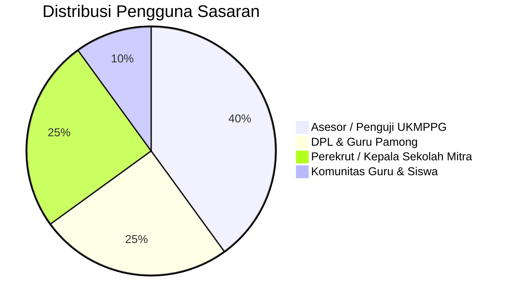
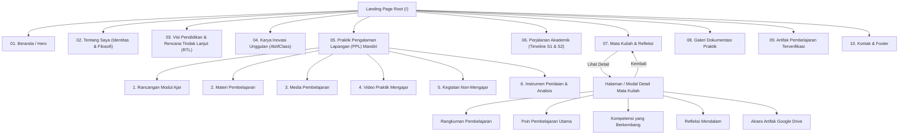
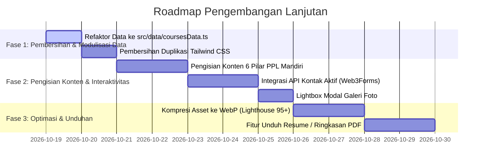

# Product Requirement Document (PRD)
# Web Portofolio Guru Profesional PPG Calon Guru

| Metadata | Keterangan |
| :--- | :--- |
| **Nama Proyek** | Web Portofolio PPG Calon Guru |
| **Pemilik Portofolio** | **Maswa Arbaurnika** |
| **Peran / Status** | Calon Guru Profesional — PPG Calon Guru 2026 |
| **Institusi / Bidang** | Pendidikan Profesi Guru (PPG) Calon Guru |
| **Versi Dokumen** | v1.3.0 |
| **Status Dokumen** | Active & Living Document (Updated with PPL Mandiri Hub) |
| **Terakhir Diperbarui** | Oktober 2026 |

---

## 1. Pendahuluan & Visi Produk

### 1.1 Latar Belakang
Program Pendidikan Profesi Guru (PPG) Calon Guru mewajibkan setiap calon guru untuk menyusun portofolio digital komprehensif sebagai instrumen penilaian Uji Kompetensi Mahasiswa PPG (UKMPPG). Portofolio ini tidak sekadar menjadi etalase dokumen administratif, melainkan media refleksi kritis yang membuktikan transformasi kompetensi pedagogik, kepribadian, sosial, dan profesional mahasiswa selama perkuliahan, PPL Terbimbing, PPL Mandiri, serta karya inovasi pembelajaran.

### 1.2 Visi Produk
Menghadirkan platform web portofolio digital yang estetik, modern, cepat, dan mudah diverifikasi yang mempresentasikan identitas, filosofi pendidikan, visi transformatif pendidikan nasional, karya inovasi digital unggulan (*AktifClass*), rekam jejak praktik klinis PPL Mandiri (6 pilar analisis), rekam jejak akademik, artifak modul ajar, serta dokumentasi praktik lapangan calon guru profesional secara kredibel dan terstruktur.

### 1.3 Nilai Inti & Filosofi
* **Belajar**: Menjadi pembelajar sepanjang hayat (*lifelong learner*) yang senantiasa terbuka pada kritik dan evaluasi.
* **Bertumbuh**: Mengadopsi *growth mindset* dalam menghadapi dinamika kebutuhan belajar siswa.
* **Bermanfaat**: Memberikan dampak nyata bagi peserta didik, sekolah mitra, dan komunitas pendidikan (*Ad Maiorem Dei Gloriam* — demi kemuliaan yang lebih besar).

---

## 2. Target Pengguna & Persona



### Persona 1: Dr. Budi Santoso (Asesor / Penguji UKMPPG)
- **Tujuan**: Memverifikasi pemenuhan standar kompetensi lulusan PPG Calon Guru melalui dokumen artifak, modul ajar, refleksi, karya inovasi pembelajaran (*AktifClass*), dan rekam jejak klinis PPL Mandiri (6 pilar).
- **Kebutuhan**: Navigasi cepat tanpa sesak, tautan dokumen valid di Google Drive, kejelasan sintaks refleksi mendalam, bukti karya inovasi, dan telaah analitis PPL Mandiri.
- **Pain Point**: Link dokumen rusak/404, ketiadaan refleksi akhir/RTL, navigasi berantakan.

### Persona 2: Ibu Rahayu, M.Pd (Guru Pamong & Dosen Pembimbing)
- **Tujuan**: Meninjau perkembangan mahasiswa selama asistensi mengajar, pelaksanaan PPL terbimbing, hingga mandiri dan implementasi 6 aspek pembelajaran di kelas.
- **Kebutuhan**: Melihat dokumentasi visual kegiatan kelas, modul ajar kontekstual, video praktik mengajar, dan instrumen asesmen.
- **Pain Point**: Foto dokumentasi tidak memiliki konteks atau gambar rusak.

### Persona 3: Bapak Hendra (Kepala Sekolah Calon Pengguna Lulusan)
- **Tujuan**: Merekrut guru baru yang memiliki karakter unggul, kemampuan pedagogik adaptif, penguasaan teknologi pembelajaran digital, dan kepemimpinan kelas nyata.
- **Kebutuhan**: Memahami filosofi mengajar, visi transformasi pendidikan, kemampuan integrasi PSE dan gamifikasi (*AktifClass*), serta rekam jejak tugas non-mengajar di sekolah.
- **Pain Point**: Tidak adanya kontak langsung atau profil yang terkesan kaku/generik.

---

## 3. Peta Navigasi & Arsitektur Informasi (IA)

Situs mengadopsi model *Single Page Application* (SPA) dengan tampilan detail modular dan *smooth scrolling*:



---

## 4. Spesifikasi Fitur Fungsional

### 4.1 F-01: Header & Navigasi Utama Terkonsolidasi
- **Deskripsi**: Bilah navigasi melayang (*sticky header*) dengan efek *backdrop blur* yang telah dirampingkan menjadi 8 tombol konsolidasi yang tidak membuat navbar kepenuhan:
  1. `Beranda` (`#beranda`)
  2. `Profil & Visi` (`#tentang` -> memuat profil & visi RTL)
  3. `Karya Inovasi` (`#inovasi`)
  4. `Praktik PPL` (`#ppl-mandiri`)
  5. `Akademik` (`#matakuliah`)
  6. `Galeri` (`#galeri`)
  7. `Artifak` (`#artifak`)
  8. `Kontak` (`#kontak`)
- **Perilaku**: Smooth scroll ke target section ID; responsif dengan tab geser horizontal pada mobile screen.

### 4.2 F-02: Hero Section (Identitas Utama)
- **Elemen**: Badge micro-label `✧ PORTOFOLIO PROFESIONAL PPG CALON GURU`, nama Maswa Arbaurnika, tagline personal, kartu status "Calon Guru Profesional · PPG Calon Guru 2026", serta tombol aksi CTA.

### 4.3 F-03: Tentang Saya & Filosofi Pendidikan (Seksi 01)
- **Komponen**: Foto profil resmi, domisili Sleman D.I. Yogyakarta, kisah personal inspirasi pendidik, motivasi menjadi guru, dan 3 pilar filosofi (Sokrates, Rousseau, dan Sistem Among Ki Hajar Dewantara).

### 4.4 F-04: Visi Pendidikan, Komitmen Guru Profesional, & RTL (Seksi 02)
- **Transformasi Pendidikan Nasional**: Menuntun kodrat, merayakan keberagaman, pembelajaran berdiferensiasi, HOTS, dan PSE.
- **4 Langkah Guru Profesional**: Praktisi Reflektif (*Reflective Practitioner*), Pembelajar Sepanjang Hayat (*Lifelong Learner* - PTK), Kolaborator Komunitas Praktisi (MGMP/KKG/PMM), dan Keteladanan Sistem Among.
- **RTL (3 Aksi Konkret Memulai Karier)**: (1) Asesmen Diagnostik Kognitif & Non-kognitif, (2) Budaya Kelas Positif Berbasis PSE, (3) Kolaborasi Segitiga Emas (Sekolah, Orang Tua, Mitra).

### 4.5 F-05: Karya Inovasi Pembelajaran — AktifClass (Seksi 03)
- **Deskripsi**: Showcase interaktif karya inovasi digital berbasis web untuk mengatasi kesenjangan keaktifan siswa di kelas.
- **Empat Tab Rubrik Utama**:
  1. *Identitas Karya*: AktifClass (*Interactive Classroom Engagement System*), web-based app untuk siswa kolaboratif & inklusi murid pemalu.
  2. *Gagasan & Riset*: Mengatasi dominasi vs kecemasan berbicara; landasan teori *Psychological Safety* (Amy Edmondson) & Gamifikasi (Deterding).
  3. *Rancangan & 5 Fitur*: Digital Buzzer, Estafet Tantangan, Wall of Argument (Mode Anonim), Randomizer, dan Class Energy Meter (disertai tombol simulasi interaktif).
  4. *Evaluasi 3 Dimensi*: Kebaruan (*Novelty*), Kreativitas (*Creativity*), dan Kebermanfaatan (*Impact*).

### 4.6 F-06: Praktik Pengalaman Lapangan (PPL) Mandiri — 6 Pilar Analisis (Seksi 04)
- **Deskripsi**: Hub klinis terstruktur yang menyajikan 6 pilar evaluasi pelaksanaan PPL Mandiri di sekolah mitra melalui antarmuka tab tombol rapi:
  1. 📋 **Rancangan / Perencanaan Pembelajaran**: Analisis produk modul ajar, penerapan prinsip Understanding by Design (UbD), dan diferensiasi.
  2. 📚 **Materi Pembelajaran**: Analisis kedalaman materi bahan ajar, kontekstualisasi kearifan lokal, dan literasi-numerasi.
  3. 🎨 **Media Pembelajaran**: Analisis efektivitas alat peraga, media digital, dan interaktivitas alat bantu kelas.
  4. 🎥 **Video Praktik Mengajar**: Analisis rekaman video mengajar mandiri, alokasi waktu, sintaks mengajar, dan interaksi murid.
  5. 🏫 **Kegiatan Non-Mengajar**: Dokumentasi kontribusi tugas persekolahan (piket, upacara, pembinaan ekskul, administrasi).
  6. 📊 **Instrumen Penilaian & Analisis**: Evaluasi kisi-kisi asesmen kognitif/afektif/psikomotorik, rubrik, dan analisis ketuntasan belajar.
- **Status Implementasi**: **Struktur tombol pilar interaktif telah aktif dan tertata rapi (Shell UI Ready)**. Konten uraian analisis mendalam siap dimasukkan saat data final tersedia.

### 4.7 F-07: Perjalanan Akademik (Timeline & Accordion) (Seksi 05)
- **Deskripsi**: Timeline interaktif semester 1 dan semester 2 dengan accordion per mata kuliah yang memuat pembelajaran utama, kompetensi, dan refleksi.

### 4.8 F-08: Modul Mata Kuliah & Tampilan Detail (Seksi 06)
- **Deskripsi**: Grid filterable (*Semua*, *SEMESTER 1*, *SEMESTER 2*) dengan kartu mata kuliah dan halaman detail mendalam beserta tombol buka artifak Google Drive.

### 4.9 F-09: Galeri Dokumentasi Praktik Lapangan (Seksi 07)
- **Deskripsi**: Dokumentasi visual kegiatan nyata PPL (Praktik mengajar, bimbingan guru pamong, dan presentasi inovasi) dalam layout 3 kolom responsif.

### 4.10 F-10: Hub Artifak Terverifikasi (Seksi 08)
- **Deskripsi**: Matriks tabel verifikasi 11 mata kuliah dengan tautan resmi Google Drive (`target="_blank"`, `rel="noopener noreferrer"`).

### 4.11 F-11: Formulir Kontak & Footer (Seksi 09)
- **Deskripsi**: Form hubungi calon guru dan footer resmi hak cipta © 2026.

---

## 5. Model Data & Entitas Sistem

```typescript
export type Semester = 'SEMESTER 1' | 'SEMESTER 2';
export type CourseCategory = 'Pedagogik' | 'PPL' | 'Refleksi' | 'PSE' | 'Kepemimpinan';

export interface PPLMandiriPillar {
  id: 'rancangan' | 'materi' | 'media' | 'video' | 'nonmengajar' | 'penilaian';
  icon: string;
  title: string;
  subtitle: string;
  analysisContent?: string;
  artifactUrl?: string;
}
```

---

## 6. Persyaratan Non-Fungsional (NFR)

| Kategori | Parameter | Target Spesifikasi |
| :--- | :--- | :--- |
| **Kinerja Web (Web Vitals)** | Google Lighthouse | Skor Kinerja \(\ge 90\), Accessibility \(\ge 95\), Best Practices \(\ge 95\), SEO \(\ge 90\). |
| **Kecepatan Muat** | First Contentful Paint (FCP) | < 1.2 detik pada koneksi 4G standar. |
| **Aksesibilitas** | Standar WCAG 2.1 AA | Kontras warna teks \(\ge 4.5:1\), tombol memiliki `aria-label`, navigasi dapat dioperasikan penuh via keyboard (Tab / Enter). |
| **Responsivitas** | Multi-device Layout | Berfungsi sempurna pada resolusi Mobile (360px - 480px), Tablet (768px), Laptop/Desktop (1024px - 1440px+). |
| **Keamanan Data** | Client-Side Security | Rel `noopener noreferrer` pada seluruh external links; proteksi XSS pada input teks. |
| **SEO & Sharing** | Open Graph Protocol | Meta tags lengkap (`title`, `description`, `og:image`, `og:title`) untuk preview profesional di WhatsApp, Telegram, dan LinkedIn. |
| **Kompatibilitas** | Web Browsers | Chromium modern (Chrome, Edge, Brave), Firefox, Safari iOS & macOS. |

---

## 7. Status Audit Kode & Riwayat Perubahan (Changelog)

### Ringkasan Pembaruan (v1.3.0):
1. **Perapian & Konsolidasi Navigasi (Header)**: Merampingkan tombol navigasi menjadi 8 tombol terorganisir (`Beranda`, `Profil & Visi`, `Karya Inovasi`, `Praktik PPL`, `Akademik`, `Galeri`, `Artifak`, `Kontak`) agar header tidak sesak di berbagai ukuran layar.
2. **Penyediaan Shell & Tombol PPL Mandiri (F-06)**: Menambahkan seksi khusus `04 · PRAKTIK PPL MANDIRI` dengan 6 tombol pilar interaktif (Rancangan, Materi, Media, Video Praktik, Non-Mengajar, Penilaian) tanpa mengisi konten analisis terlebih dahulu sesuai arahan pengguna.
3. **Pembaruan Nomenklatur & SEO**: Mempertahankan istilah resmi `PPG Calon Guru` dan meta tags lengkap.
4. **Verifikasi Build & Linting**: Status build `npm run build` dan `npm run lint` telah diverifikasi bersih (**0 error / 0 warning**).

---

## 8. Rencana & Roadmap Pengembangan Selanjutnya



---

## 9. Kriteria Penerimaan (*Acceptance Criteria*)

- [x] Navigasi header tertata rapi, tidak sesak, dan terkonsolidasi secara proporsional.
- [x] Terdapat seksi resmi Praktik PPL Mandiri dengan 6 tombol pilar interaktif yang dapat diklik bergantian.
- [x] Konten pada 6 pilar PPL Mandiri berupa shell / placeholder terstruktur (belum diisi konten mendalam sebelum data diberikan).
- [x] Seluruh tautan artifak Google Drive dapat diklik dan terbuka di tab baru (`rel="noopener noreferrer"`).
- [x] Skor pengujian build (`npm run build`) dan linting (`npm run lint`) bernilai **0 error / 0 warning**.
- [ ] Pengisian narasi analisis 6 pilar PPL Mandiri (Menunggu data dari pengguna).
